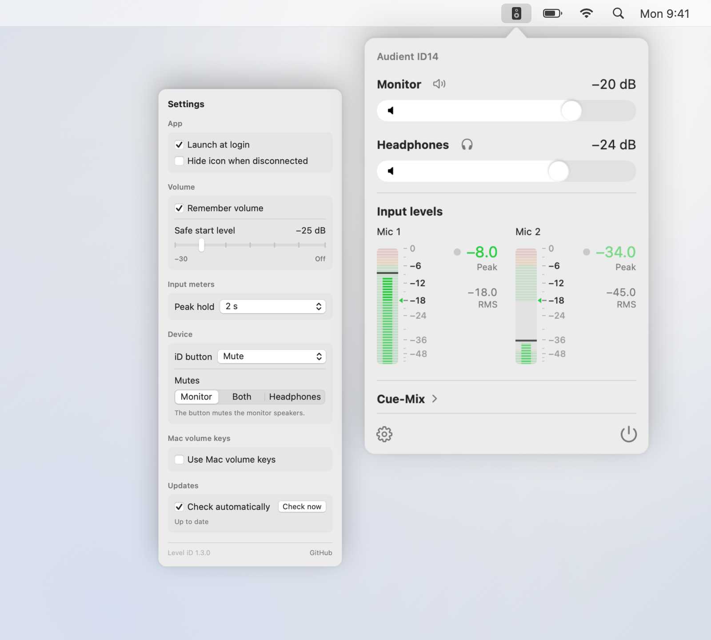

# Level iD

A tiny, free menu bar app for **Audient iD interfaces** (iD14 MkII; iD24 unverified, iD44 in beta) on macOS. It remembers your monitor and headphone volume when you unplug the interface, shows the microphone levels the iD14 itself can't show, and uses almost no resources.

> Level iD is an independent project. It is not affiliated with, endorsed by, or supported by Audient. "Audient" and "iD" are trademarks of their respective owners.

<p align="center">
  <a href="https://github.com/franzranz/level-id/releases/latest/download/Level-iD.dmg"></a>
  <br>
  <sub>Free · Apple silicon Mac · macOS 14 or newer · Audient iD14 MkII (iD24 unverified, iD44 in beta)</sub>
</p>

<p align="center">
  <picture>
    <source media="(prefers-color-scheme: dark)" srcset="docs/hero-dark.png">
    
  </picture>
</p>

## Supported devices

| Device | Status |
|---|---|
| iD14 MkII | ✓ Supported |
| iD24 | Unverified – read-only (same layout as the iD14; meters and volume display, control is enabled once an owner confirms it) |
| iD44 | Beta – read-only (meters for all four inputs; no cue mix yet) |
| iD44 MkII | Beta – read-only (meters for all four inputs; no cue mix yet) |
| iD4 / iD4 MkII | Not supported – the iD4 has no software-controllable monitor volume |

Own an iD24 or iD44? You can help: Level iD detects the device automatically in read-only mode. Open Settings → "Help verify this device…", follow the five steps (turn the knobs, press the iD button, speak into each input, re-plug) and click "Open GitHub issue" to submit the anonymous report. Nothing is sent automatically.

## Why

The iD14 forgets its volume every time you unplug it, has no meters for your microphones, and Audient's iD app is heavy and cluttered. Level iD fixes this from the menu bar.

## Features

- **Remembers volume.** Monitor and headphones fade back in after replugging, capped by a "Safe start level".
- **Input meters.** The levels the iD14 itself doesn't show.
  - One meter per input, peak hold, clip light
  - **RMS** for setting normal levels, **PPM** for podcasts – click the value to switch
  - Target zone, marker and −6/−12/−18 dB labels: turn the gain until your voice sits in the zone
- **Tiny.** About 0 % CPU and under 28 MB of memory.
- **Cue mix.** Blend your live mic with computer playback.
- **iD button.** Mute (monitor, headphones or both), Mono, Alt speakers or Talkback.
- **Talkback.** Mic 1, Mic 2, both or the Mac mic, headphones only.
- **Mac volume keys** (optional, off by default). Volume and mute keys control the iD14. Needs the Accessibility permission.
- **Speaker pair switch.** Output 1/2 or 3/4.

## The problem with the original iD software

- **Volume starts at zero.** After every replug or restart, monitors and headphones are silent, and iD doesn't restore your level. You reach for the knob every time, and if you turn it too fast, it gets loud.
- **No input metering on the device.** The LED ring only shows the output. To see your mic level, iD (or a DAW) has to be open on screen.
- **Gain meters that don't help you set gain.** iD shows plain peak bars: no RMS, no peak hold, no target zone or reference marks. You can see when it clips, but not whether your level is actually right.
- **A volume knob on screen.** iD copies the hardware knob into the app, so you change the volume by dragging a round knob with the mouse. That is awkward and imprecise.
- **Cluttered interface.** Lots of buttons, with mixer, routing, monitor controls and settings crammed into one big window. Simple things like checking a level take a lot of looking.
- **Confusing settings.** The options are hard to find and hard to understand.
- **Heavy for what it does.** iD uses about 15–30 % CPU and 160 MB of memory while it runs, even with its window closed.

## What it cannot do

Gain, 48 V phantom power and the Hi-Z instrument switch are analog on the iD14 and cannot be read or set over USB. The LED meter source and the firmware cannot be changed either.

## Requirements

- Apple silicon Mac (M1 or newer), macOS 14 Sonoma or newer
- Audient iD14 MkII, or an iD24 (unverified) or iD44 (beta) (see [Supported devices](#supported-devices))

## Install (3 steps)

1. **Download** [Level-iD.dmg](https://github.com/franzranz/level-id/releases/latest/download/Level-iD.dmg) and open it.
2. **Drag** the Level iD icon onto the Applications folder.
3. **Open** Level iD from Applications. macOS warns the first time because the app isn't from the App Store:
   - macOS 14: right-click Level iD, choose **Open**, then **Open** again.
   - macOS 15 and newer: open it once, close the warning, then go to **System Settings → Privacy & Security**, scroll down and click **Open Anyway**.

That's it. Plug in your iD14 and the icon appears in the menu bar. You only have to do the warning step once.

Please quit Audient's own iD app while you use Level iD. If iD is running, Level iD only watches and changes nothing.

## Updates

Level iD checks for new versions at most once a week (Settings → Updates → "Check automatically", on by default; untick it to turn it off). It never installs anything without your click. You can also click "Check now" at any time. The only thing sent is the request to GitHub's public releases API (with the user agent `LevelID/<version>`). No personal data, no identifiers.

"Install and restart" downloads the new version, verifies its SHA-256 checksum and its code signature (it must carry the same signature as the app you are running), moves the old app to the Trash and restarts. If anything fails, nothing is replaced. Copies that are signed ad hoc, or that are not in the Applications folder, only show a link to the release page.

## Build from source

You need the Xcode Command Line Tools (Swift 5.10 or newer).

```bash
./build.sh test      # offline tests, no device access
./build.sh app       # builds .build/Level iD.app
./build.sh dist      # builds a DMG
./build.sh install   # installs to /Applications
```

If your Command Line Tools are broken, put local overrides (`OVERLAY`, `SDK`, `CPLUS_INCLUDE_PATH`) into a git-ignored `.buildenv` file next to `build.sh`.

## How it works

The iD14 is a USB Audio Class 2 device. All controls are UAC2 class requests on endpoint 0. The device does not store its state, so after every plug-in the host must resend it. The protocol is documented in [docs/PROTOCOL.md](docs/PROTOCOL.md).

Level iD only sends control commands that Audient's own iD app also sends. It never touches the firmware.

## Help wanted

This is a small hobby project and I would love some help. See [CONTRIBUTING.md](CONTRIBUTING.md) for details.

- **Feedback.** Does it work for you? Is something confusing, missing, or annoying? Open an [issue](../../issues), every report helps.
- **iD24 and iD44 owners.** These models run read-only for now (iD24 unverified, iD44 beta). Use Settings → "Help verify this device…" and submit the report as a GitHub issue, so control can be enabled. The iD4 cannot be supported (no software volume control). Protocol notes are in [docs/PROTOCOL.md](docs/PROTOCOL.md).
- **Testing on other setups.** Different Macs, macOS versions, light mode, several displays, sleep and wake, unusual cabling.
- **Open questions about the iD14 MkII.** Is the +10 dB boost on input 1 controllable over USB? Which routing code switches loopback on? Does a newer firmware behave differently?
- **Packaging.** Code signing and notarization (needs an Apple Developer account), a Homebrew cask, and translations.

## Safety and disclaimer

This is unofficial software. It controls volumes on your audio interface. Use it at your own risk and keep your speakers and ears safe: the "Safe start level" setting exists for that reason. Tested with one iD14 MkII on macOS 14.

## License

[MIT](LICENSE)
