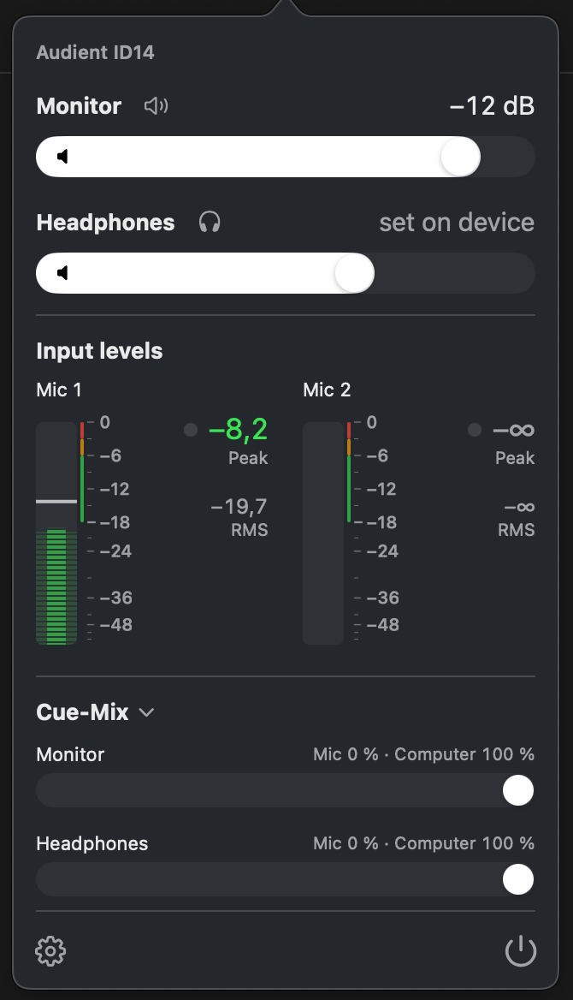

# Level iD

A tiny, free menu bar app for the **Audient iD14 MkII** on macOS. It remembers your monitor and headphone volume when you unplug the interface, shows input levels while you set the gain, and uses almost no resources.

> Level iD is an independent project. It is not affiliated with, endorsed by, or supported by Audient. "Audient" and "iD" are trademarks of their respective owners.

<p align="center">
  <a href="https://github.com/franzranz/level-id/releases/latest/download/Level-iD.dmg"></a>
  <br>
  <sub>Free · Apple silicon Mac · macOS 14 or newer · Audient iD14 MkII</sub>
</p>

<p align="center">
  
  
</p>

## Why

The iD14 starts at zero volume after every replug, and Audient's iD app doesn't restore it. iD also needs about 15–30 % CPU and 160 MB of memory while it runs. Level iD fixes both:

- **Remembers volume.** Monitor and headphones fade back in after replugging, capped by a "Safe start level".
- **Tiny.** About 0 % CPU and under 40 MB of memory (Activity Monitor), compared to about 160 MB for iD.
- **Pro gain meter.** IEC scale, peak and RMS, peak hold and a clip light. Much clearer than iD's meters for setting gain.
- **Cue mix.** Blend your live mic with computer playback.
- **iD button.** Mute (monitor, headphones or both), Mono, Alt speakers or Talkback.
- **Talkback.** Mic 1, Mic 2, both or the Mac mic, headphones only.
- **Mac volume keys** (optional, off by default). Volume and mute keys control the iD14. Needs the Accessibility permission, which has to be granted again after each update.
- **Speaker pair switch.** Output 1/2 or 3/4.

## What it cannot do

Gain, 48 V phantom power and the Hi-Z instrument switch are analog on the iD14 and cannot be read or set over USB. The LED meter source and the firmware cannot be changed either.

## Requirements

- Apple silicon Mac (M1 or newer), macOS 14 Sonoma or newer
- Audient iD14 MkII (other Audient interfaces are not supported)

## Install (3 steps)

1. **Download** [Level-iD.dmg](https://github.com/franzranz/level-id/releases/latest/download/Level-iD.dmg) and open it.
2. **Drag** the Level iD icon onto the Applications folder.
3. **Open** Level iD from Applications. macOS warns the first time because the app isn't from the App Store:
   - macOS 14: right-click Level iD, choose **Open**, then **Open** again.
   - macOS 15 and newer: open it once, close the warning, then go to **System Settings → Privacy & Security**, scroll down and click **Open Anyway**.

That's it. Plug in your iD14 and the icon appears in the menu bar. You only have to do the warning step once.

Please quit Audient's own iD app while you use Level iD. If iD is running, Level iD only watches and changes nothing.

## Build from source

You need the Xcode Command Line Tools (Swift 5.10 or newer).

```bash
./build.sh test      # offline tests, no device access
./build.sh app       # builds .build/Level iD.app
./build.sh dist      # builds a DMG
./build.sh install   # installs to /Applications
```

If your Command Line Tools are broken, put local overrides (`OVERLAY`, `SDK`, `CPLUS_INCLUDE_PATH`) into a git-ignored `.buildenv` file next to `build.sh`.

## How it works

The iD14 is a USB Audio Class 2 device. All controls are UAC2 class requests on endpoint 0. The device does not store its state, so after every plug-in the host must resend it. The protocol is documented in [docs/PROTOCOL.md](docs/PROTOCOL.md).

Level iD only sends control commands that Audient's own iD app also sends. It never touches the firmware.

## Help wanted

This is a small hobby project and I would love some help. See [CONTRIBUTING.md](CONTRIBUTING.md) for details.

- **Feedback.** Does it work for you? Is something confusing, missing, or annoying? Open an [issue](../../issues), every report helps.
- **Other Audient interfaces.** If you own an iD4, iD22, iD24 or iD44, you are welcome to try this and help extend support. The protocol notes are in [docs/PROTOCOL.md](docs/PROTOCOL.md), and the read-only `id14ctl` tool (`./build.sh probe`) shows what a device reports. Other models are not supported yet, and I cannot test them myself.
- **Testing on other setups.** Different Macs, macOS versions, light mode, several displays, sleep and wake, unusual cabling.
- **Open questions about the iD14 MkII.** Is the +10 dB boost on input 1 controllable over USB? Which routing code switches loopback on? Does a newer firmware behave differently?
- **Packaging.** Code signing and notarization (needs an Apple Developer account), a Homebrew cask, and translations.

## Safety and disclaimer

This is unofficial software. It controls volumes on your audio interface. Use it at your own risk and keep your speakers and ears safe: the "Safe start level" setting exists for that reason. Tested with one iD14 MkII on macOS 14.

## License

[MIT](LICENSE)
