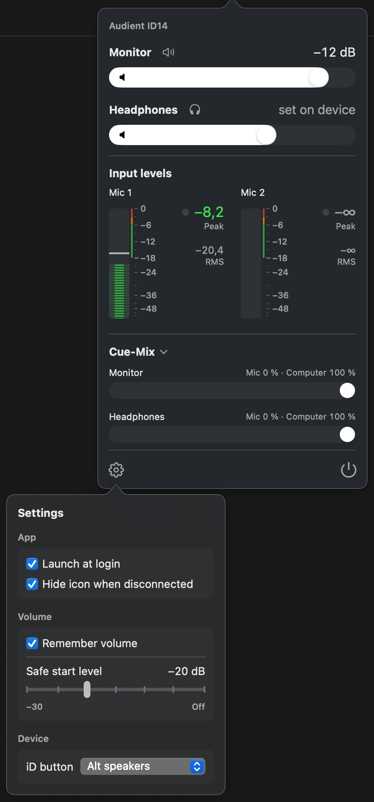

# Level iD

A tiny, free menu bar app for the **Audient iD14 MkII** on macOS. It remembers your monitor and headphone volume when you unplug the interface, shows input levels while you set the gain, and uses almost no resources.

> Level iD is an independent project. It is not affiliated with, endorsed by, or supported by Audient. "Audient" and "iD" are trademarks of their respective owners.

<p align="center">
  
  
</p>

## Why

The iD14 forgets its monitor volume every time it is unplugged and comes back silent. The official iD software restores the mixer but not the volume, and it keeps the CPU busy while it runs. Level iD fixes both:

- **Remembers volume.** Monitor and headphone volume come back after replugging, faded in over 0.3 s and capped by a "Safe start level" so you never blast your ears or speakers.
- **Light on resources.** About 0 % CPU and 14 MB of RAM with the panel closed (the official iD app used about 15 % CPU in our measurements).
- **Input level meters** with RMS, peak hold, and a clip indicator, to help you set the gain.
- **Cue mix** blend between your live microphone and computer playback.
- **iD button** assignment: Off, Mute (monitor, headphones, or both), Mono, Alt speakers, or Talkback.
- **Talkback** from mic 1, mic 2, both, or the Mac microphone, heard in the headphones only.
- **Mac volume keys** (optional, off by default): while the iD14 is the Mac's sound output, the volume and mute keys control its monitor or headphone volume, with a small on-screen display. Shift = 0.1 dB steps. Turn it on in Settings; macOS asks for the Accessibility permission. Level iD is signed ad hoc, so with unsigned builds the permission must be re-granted after each update (remove the app from the list and add it again).
- **Speaker pair switch** for monitors on Output 1/2 or 3/4.

## What it cannot do

Gain, 48 V phantom power and the Hi-Z instrument switch are analog on the iD14 and cannot be read or set over USB. The LED meter source and the firmware cannot be changed either.

## Requirements

- Apple silicon Mac (M1 or newer), macOS 14 Sonoma or newer
- Audient iD14 MkII (other Audient interfaces are not supported)

## Install

1. Download the latest `Level-iD-<version>.dmg` from the [Releases](../../releases) page and drag **Level iD** to Applications.
2. The app is not notarized by Apple, so macOS warns on first launch:
   - macOS 14: right-click the app, then Open, then Open.
   - macOS 15 and newer: launch it once, then go to System Settings, Privacy & Security, and click "Open Anyway".
3. Plug in the iD14. The icon appears in the menu bar.

Do not run Audient's own iD app at the same time. While iD is running, Level iD switches to read-only automatically.

## Build from source

You need the Xcode Command Line Tools (Swift 5.10 or newer).

```bash
./build.sh test      # offline tests, no device access
./build.sh app       # builds .build/Level iD.app
./build.sh dist      # builds a DMG
./build.sh install   # installs to /Applications
```

If your Command Line Tools are broken, put local overrides (`OVERLAY`, `SDK`, `CPLUS_INCLUDE_PATH`) into a git-ignored `.buildenv` file next to `build.sh`.

## How it works

The iD14 is a USB Audio Class 2 device. All controls are UAC2 class requests on endpoint 0. The device does not store its state, so after every plug-in the host must resend it. The protocol is documented in [docs/PROTOCOL.md](docs/PROTOCOL.md).

Level iD only sends control commands that Audient's own iD app also sends. It never touches the firmware.

## Help wanted

This is a small hobby project and I would love some help. See [CONTRIBUTING.md](CONTRIBUTING.md) for details.

- **Feedback.** Does it work for you? Is something confusing, missing, or annoying? Open an [issue](../../issues), every report helps.
- **Other Audient interfaces.** If you own an iD4, iD22, iD24 or iD44, you are welcome to try this and help extend support. The protocol notes are in [docs/PROTOCOL.md](docs/PROTOCOL.md), and the read-only `id14ctl` tool (`./build.sh probe`) shows what a device reports. Other models are not supported yet, and I cannot test them myself.
- **Testing on other setups.** Different Macs, macOS versions, light mode, several displays, sleep and wake, unusual cabling.
- **Open questions about the iD14 MkII.** Is the +10 dB boost on input 1 controllable over USB? Which routing code switches loopback on? Does a newer firmware behave differently?
- **Packaging.** Code signing and notarization (needs an Apple Developer account), a Homebrew cask, and translations.

## Safety and disclaimer

This is unofficial software. It controls volumes on your audio interface. Use it at your own risk and keep your speakers and ears safe: the "Safe start level" setting exists for that reason. Tested with one iD14 MkII on macOS 14.

## License

[MIT](LICENSE)
